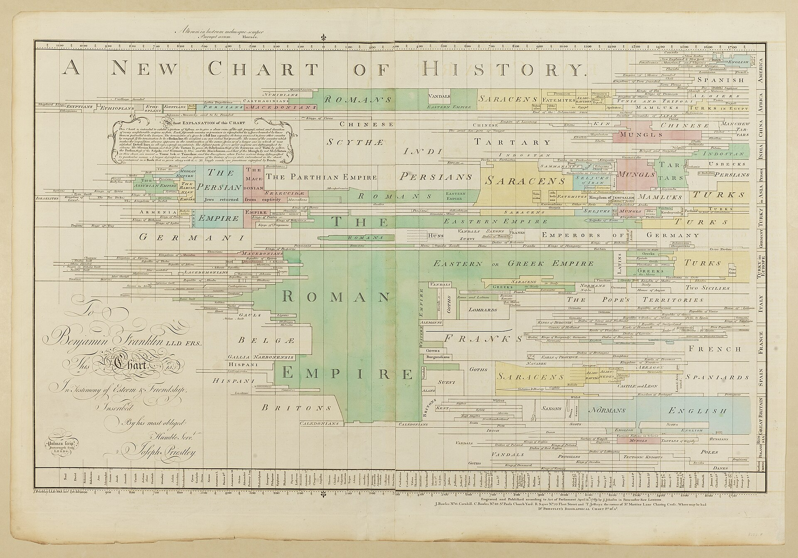

# 普里斯特利《历史新图》

**所属类型**　编年型信息图形

**读图问题**　固定一个世纪，可以同时看到哪些地区的政权？

## 数据逻辑与结构

记录可拆成「地区｜政权｜开始年｜结束年」。横向是共同的年代，右边列出中国、印度、波斯、意大利等地区。一个政权可以在相邻地区的条带中连续出现。按地区拆分后，可以追踪同一时期的并存和更替。

## 统计图形与计算

借用区间图。条带的两端对准起止年代，水平跨度表达延续时长。需要计量时应先明确跨公元前后的纪年规则。跨多个地区的色带可提示覆盖范围，条带高度和面积不能用来读取领土面积。

## 视觉编码

上下边缘设年代刻度，竖向格线把同一年代贯穿各地区。名称直接写在区间内。大块绿色的 ROMAN EMPIRE 用颜色与连续边界贯穿多个地区，细线则容纳持续较短或范围较窄的记录。

## 信息架构

结构可以分成三层。上下年尺是总索引，右侧地区名是分组入口，组内的色带和文字对应一个个政权区间。图中附有原作者关于读图方式的说明。

## 视觉叙事架构

先在右侧选地区，沿横向读更替。再固定一个世纪沿竖向扫描，比较当时并行存在的名称。由大块罗马帝国色带进入，能同时看见某一政权的跨度和跨区联系。

## 数据与编码检验

把每个政权的地区与年代拆为一行，主键使用「地区＋政权＋起始位置」。比较两段是否同时存在时，可求区间交集 `[max(a.start,b.start), min(a.end,b.end))`。

半开区间可以明确结束位置。若图上只有世纪标注，应记录估读所用的刻度，避免在表里凭空添加年份精度。

## 来源与署名

- Joseph Priestley，1769 年。数字化图像出自 Library Company of Philadelphia 馆藏。
- [图像出处](https://commons.wikimedia.org/wiki/File:A_New_Chart_of_History_color.jpg)
- 来源文件页将历史原作标记为公有领域。仓库收录完整彩色图版。
