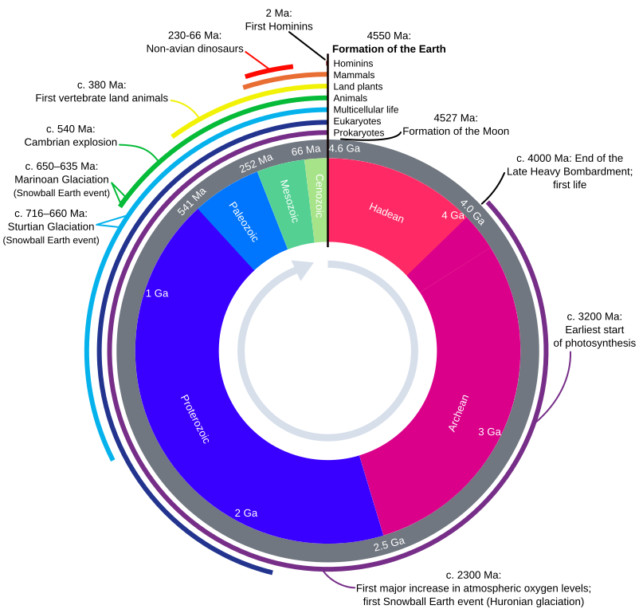

# 地球地质时钟

**所属类型**　编年型信息图形

**读图问题**　把地球历史压进一圈，哪些时期占据最大篇幅，生命事件出现得有多晚？

## 数据逻辑与结构

记录分为地质时期、事件和延续区间三种。时期有起止，事件有一个距今年代，外环条带标示若干类生物出现后延续的区间。图中同时出现 Ga 和 Ma，两者相差一千倍。

## 统计图形与计算

借用环形比例轴。以约 4.55 Ga 对应一整圈，持续时间可换算为圆心角。主要事件用标注连到相应位置。环形本身保留时序，但把地球形成和现在放得很近，需要借助方向提示。

## 视觉编码

彩色扇环用色相区分时期，外弧区分不同生物类群，细引线把事件文字接到轴上。年代刻度布置在环上，靠近当代的一簇短时段则集中在上方。

## 信息架构

内环的地质时期构成全景，年代刻度位于环外，生命和环境事件通过外弧或引线叠放。先区分时期、类群和事件三种记录，再比较各自的时间位置。

## 视觉叙事架构

先从顶端的地球形成标签出发，按图示顺时针走过冥古宙、太古宙等区间，再回到接近今天的分段。最后观察顶部的人族标记。版面上很小的夹角正是这张图要传达的信息。

## 数据与编码检验

把原图的 4,550 Ma 设为一圈，并取图标的地月形成事件 4,527 Ma。二者相差 23 Ma，对应的夹角为 `23 / 4550 × 360 ≈ 1.82°`。

环绕后起点与末端在版面上接近，要用时间值判定相隔多久。

## 来源与署名

- Woudloper，Hardwigg 矢量改绘，2010 年
- [图像出处](https://commons.wikimedia.org/wiki/File:Geologic_Clock_with_events_and_periods.svg)
- 来源页标记为公有领域。
