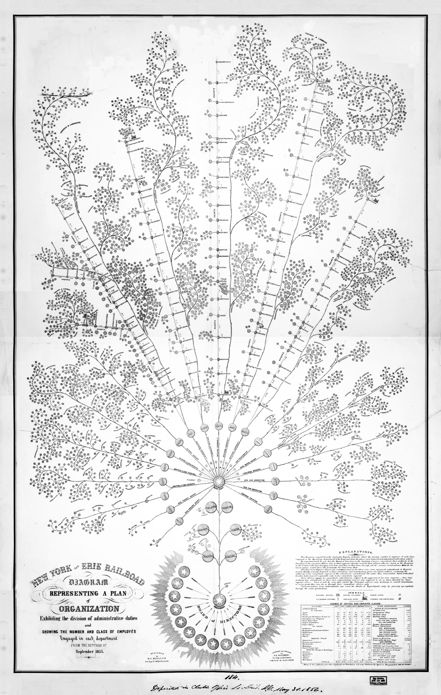

# 纽约与伊利铁路组织图

**所属类型**　层级型信息图形

**读图问题**　一家铁路公司如何把许多部门和岗位汇总在一张管理图里？

## 数据逻辑与结构

把管理与岗位单位视为节点。记录至少需要「节点编号｜上级编号｜岗位或职能｜标注」。图上的主枝、次级枝以及末端的密集标记，把总结构与分支职责装进同一版面。

## 统计图形与计算

借用组织结构树。枝条的连接关系是主要数据，判定上下位时要看通向哪个节点。分配给支线的纸面面积以及同一枝条的长度，没有通用的数量比例尺。

## 视觉编码

中心结点向外放射，主枝继续分叉，边缘出现成簇的标记。下部保留图名、说明与另一组环状构成。疏密和笔触能快速突出分支，但末端需要放大后核查。

## 信息架构

中央汇合点与周边放射主枝形成总览，末端符号承载精细岗位，下部标题、说明和小表提供解释。需要查名时应先在主图定位分支。

## 视觉叙事架构

先定位主图汇合的结点，再选一条主枝，沿分叉由整体走向职能与末端角色。反向可从某个末端逐级回溯。把版面当成铁路地理线网来读，会混淆它要表达的组织关系。

## 数据与编码检验

可将放射状组织图重建为 `节点编号, 相连节点编号, 标注, 关系类型`。先沿线录连接，再用底部图例核对编号含义。

关系方向只从原图说明或可辨认的组织层级录入。分支的画面角度与径向位置属于版面变量。

## 来源与署名

- Daniel McCallum 与 George Holt Henshaw，1855 年
- [图像出处](https://commons.wikimedia.org/wiki/File:Organizational_diagram_of_the_New_York_and_Erie_Railroad%2C_1855.jpg)
- 来源页标记为公有领域。
- 仓库收录来源页提供的 3840 × 6054 像素高清图版。放大可查末端标记及底部说明。
