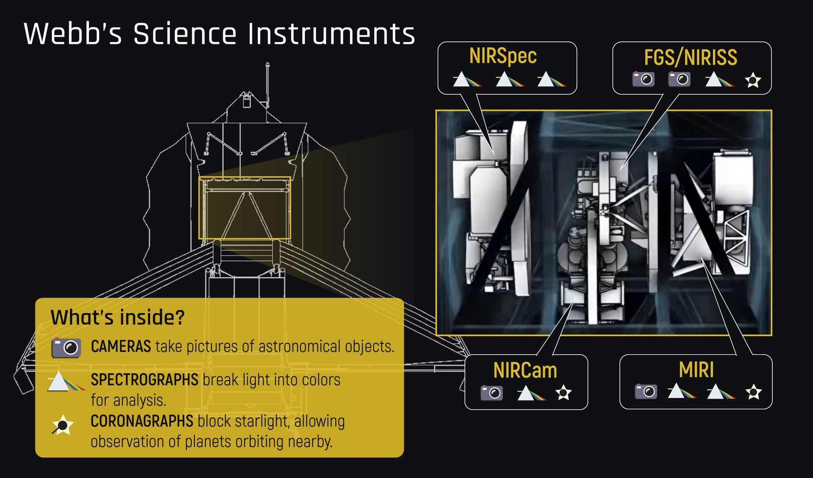

# 韦布望远镜科学仪器功能图

**表现形式**　文字型与列表型　　**主归属**　编目型

**读图问题**　怎样用功能图例快速查出四个仪器标注各包含哪些图标？

## 数据逻辑与结构

表按仪器名称逐行记录，并给相机、光谱仪、日冕仪分别建字段。可以保留原图标的重复次数，也可以归约成表示存在与否的二值矩阵。

## 统计图形与计算

四个仪器标注在实物图外按空间位置分布。图例把三种功能解释为可复用的符号。计数时应保留口径：原图中出现的图标数，或每种功能是否出现。

## 视觉编码

相机图标、带彩虹的棱镜和被遮挡的星形建立稳定的视觉词汇。黄框关联左侧整体图与右侧局部，标注引线定位仪器。

## 信息架构

左侧说明从整体定位到功能词汇，右侧从局部设备到四个并列标注。每条标注可以独立查阅，也能按共同符号横向比较。

## 视觉叙事架构

可以先从图例认出棱镜，再扫描四个标注。NIRSpec 格有三个棱镜。对照 NIRCam 格时，图标类型由一种扩展到三种。这种阅读顺序适合技术说明中的平行清单。

## 数据与编码检验

左下图例把相机、光谱仪、日冕仪编码为三列。四行的图标计数中，NIRSpec 为 `(0,3,0)`，NIRCam 为 `(1,1,1)`，MIRI 为 `(1,2,1)`，FGS/NIRISS 为 `(2,1,1)`。

这组数字只转录图面图标。若查“是否具备某类图示”，把大于零的值归约为 `1`，即可查询光谱仪图标覆盖全部四组。

## 来源与署名

- NASA、ESA、CSA、STScI，Webb’s Science Instruments，档案编号 4203。
- [图版文件页](https://commons.wikimedia.org/wiki/File:Webb%27s_Science_Instruments_(4203-Image).png)
- [NASA 仪器说明](https://science.nasa.gov/mission/webb/science-overview/science-explainers/webbs-scientific-instruments/)

[原图来源](原图来源.md) · [基础记录 CSV](基础记录.csv) · [字段说明](字段说明.md) · [返回类别目录](../README.md)
