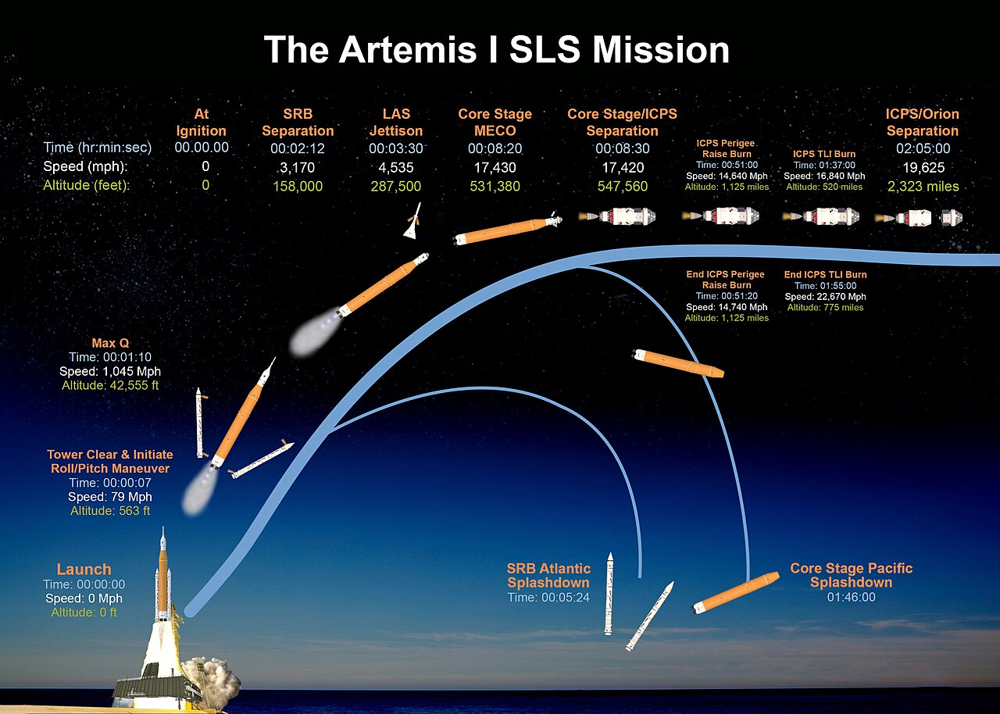

# NASA 阿耳忒弥斯一号上升阶段时间轴

**表现形式**　时间轴型　　**主归属**　编年型

**读图问题**　火箭升空后，几个分离和点火节点分别出现在什么时候？

## 数据逻辑与结构

可按「事件｜相对发射时间｜速度｜高度｜部件」记录。发射为 00:00:00，SRB 分离、LAS 抛离、主级关机等各自有时标。个别下方分支标出了落点或后续事件。

## 统计图形与计算

图中把里程碑时间轴与轨迹示意组合。顶部数字标注提供可读的时、分、秒和单位，火箭示意的位置用于讲解阶段转换。图上各节点间距并非统一的秒数比例。

## 视觉编码

顶部多列按任务先后排列，橙色标记突出动作标题，蓝色弧线引导追踪上升路线，分叉线和部件小图说明哪些器件脱离。

## 信息架构

顶部是按任务顺序的关键节点及参数，下部用主轨迹与分离支线补充空间关系。事件名、时间、速度和高度可以按顶部的一列成组对照。

## 视觉叙事架构

先从左下火箭发射入图，再沿弧线跳到顶部事件栏逐列读。发现相近节点时直接比时间标签，例如主级关机与主级／ICPS 分离，视觉距离只负责留出说明空间。

## 数据与编码检验

将 `hh:mm:ss` 转为任务起点秒数。在图面顶部，SRB 分离 `00:02:12` 为 132 秒，主发动机关机 `00:08:20` 为 500 秒，紧接的分离 `00:08:30` 为 510 秒。间隔分别为 368 秒和 10 秒。

图里同时出现英尺和英里，高度入表时保留单位，再按需要统一。示意轨迹上的间距用于布局和结构说明。

## 来源与署名

- NASA，2022 年任务新闻资料
- [图像出处](https://commons.wikimedia.org/wiki/File:Artemis_I_ascent_timeline.jpg)
- [NASA 任务资料](https://www.nasa.gov/specials/artemis-i-press-kit/)
- 来源页按美国联邦政府作品标记为公有领域。
- 仓库图片保存来源页提供的预览，保留完整画面。

[原图来源](原图来源.md) · [基础记录 CSV](基础记录.csv) · [字段说明](字段说明.md) · [返回类别目录](../README.md)
