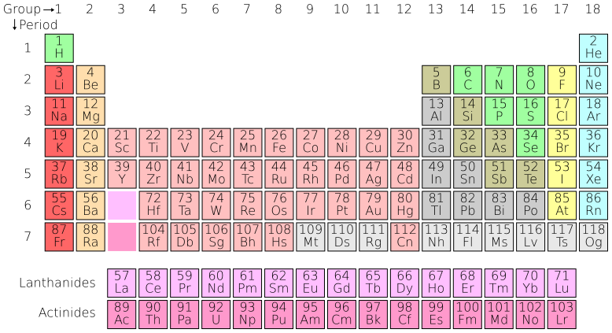

# 彩色元素周期表

**所属类型**　编目型信息图形

**读图问题**　怎样同时查到元素的原子序、符号，以及它在周期表中的位置？

## 数据逻辑与结构

一个格位是一种元素，按「原子序｜符号｜周期｜族｜类别」建表。纵向组织以族为参照，横向体现周期，格内的原子序为稳定唯一索引。下方两行展示镧系和锕系。

## 统计图形与计算

使用分类矩阵，格位与文字编码承担主要信息。原子序是整数，序号可查，但等面积方格不表达元素丰度、原子半径或质量。被移出的两行仍属于整体周期结构。

## 视觉编码

列首标族号，左侧标周期。格内用上小下大的字号分开原子序和符号，色块供快速区分。部分颜色与命名需结合原文件的说明理解，图中可用列号及格位作为第二条检索线索。

## 信息架构

整张表以族和周期编号作二维定位，再进入格内的原子序和元素符号。底部的镧系与锕系小表和主表维持同一格位样式。

## 视觉叙事架构

可先查 Na 的符号和编号，再去同一列读 K、Rb 等条目，也可先按周期扫过一行。这种矩阵能让不同入口共享一套排布，代价是初学者需要知道底部两行如何接回主体。

## 数据与编码检验

读出 Li、Na、K 的 `(周期, 族)` 分别为 `(2,1)、(3,1)、(4,1)`。同一族按周期排序得到原子序 `3 → 11 → 19`。

格位是二维坐标，元素符号是查找键。镧系、锕系等另外排布，重建整表时应单独处理映射位置。

## 来源与署名

- Cepheus，2007 年初始版本，文件页保留后续修订记录
- [图像出处](https://commons.wikimedia.org/wiki/File:Periodic_table.svg)
- 来源页标记为公有领域。
