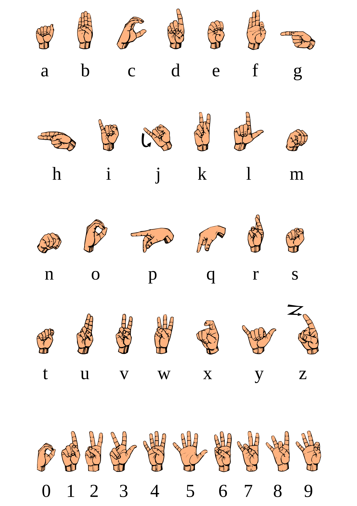

# 美国手语手指拼写对照图

**所属类型**　字母表型信息图形

**读图问题**　如何从拉丁字母定位到手指拼写的手型与动作？

## 数据逻辑与结构

一条记录是「字符｜手型｜手掌或手指方向｜可选运动轨迹」。图中以 A–Z 为字母索引，0–9 单独占一行。J 和 Z 需要动作信息，也可在记录中单列运动字段。

## 统计图形与计算

采用图示索引表。每个格位对应一种字符的手型或动作提示。信息主要通过形状及配对关系查找，全图无需频率、比例或时长统计。

## 视觉编码

字母放在手型正下方，留白使每组一眼可配对。J 的弯箭头与 Z 的折线箭头告诉读者静态插画之外还有动作。统一的肤色和轮廓使对比集中在手指姿势与掌向。

## 信息架构

字母区放在上方，数字区独立成行，同一格位以手型对下方字符。动作箭头作为附加一层，只在需要动态提示的位置出现。

## 视觉叙事架构

先从上到下定位字母段，再核对对应下标与手型。动作项可先看手型再沿箭头读轨迹。与海事旗表相比，这张图同样可查字母，但必须兼顾方向和动作。

## 数据与编码检验

用 `字符, 手型, 朝向, 动作轨迹` 组织对照表。原图在 J、Z 图例中用弯箭头和折线表达动作，应为二者保留动作字段。

可以将符号体系中的字母与数字分别设索引。查图应同时核对标签下的大小写展示。

## 来源与署名

- Darren Stone（Ds13），基于 Gallaudet-TT 字体排版，原始上传于 2004 年
- [图像出处](https://commons.wikimedia.org/wiki/File:Asl_alphabet_gallaudet.svg)
- 来源页标记为公有领域。
- 仓库图片保存来源页提供的预览，保留完整画面。
