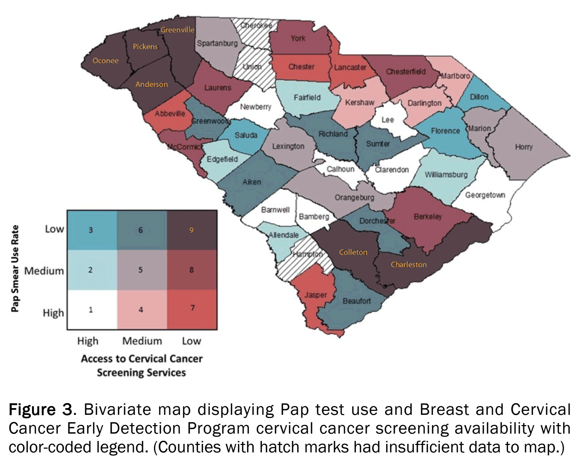

# 南卡罗来纳州双变量分级设色地图

**所属类型**　地理图形信息图形

**读图问题**　同一个县的两个比例或可及性等级，怎样合成地图中的一个颜色？

## 数据逻辑与结构

以县为连接单位。字段可拆为县代码、筛查使用率、服务可及性、两个分级结果和缺失状态。论文以三分位对两个变量分别分级。

## 统计图形与计算

图例是 3×3 矩阵。横轴从高可及到低可及，纵轴从高使用到低使用。两个等级的组合决定一个格号。作者把分级方法的选择和原始数据缺失分别说明。

## 视觉编码

图面同一颜色承担两个维度的信息。低可及、低使用落在深色 9 格，斜线区表示数据不足，可与实心的 1 格区分。

## 信息架构

以图例为入口，再在县界内找匹配色块。原图的空白底色、实心浅色区域和缺失斜线分别发挥版面、编码和数据质量标记的作用。

## 视觉叙事架构

可以先读 Charleston 和 Colleton 的深色，再回到 9 格核对双低含义。读者也能用 Florence 的 3 格找到可及性较高而使用较低的组合。县级类别支持区域比较，具体强度仍需回到原始指标。

## 数据与编码检验

以 `a=可及性等级、u=使用率等级`，各把高、中、低编码为 `1、2、3`。原图格号 `3×(a−1)+u`。Charleston 对应 `3,3 → 9`，Florence 为 `1,3 → 3`。

Cherokee、Union、Hampton 用斜线表示筛查使用率资料不足。本次转录将这些县的组合留空并走缺失分支。

## 来源与署名

- Biesecker、Zahnd、Brandt、Adams 与 Eberth，2020 年，图 3。
- [原文、方法和图例](https://www.cdc.gov/pcd/issues/2020/19_0254.htm)
- 图版由论文 PDF 第 5 页截取，包含完整地图、图例与图注。 [论文 PDF](https://stacks.cdc.gov/view/cdc/84975/cdc_84975_DS1.pdf)
