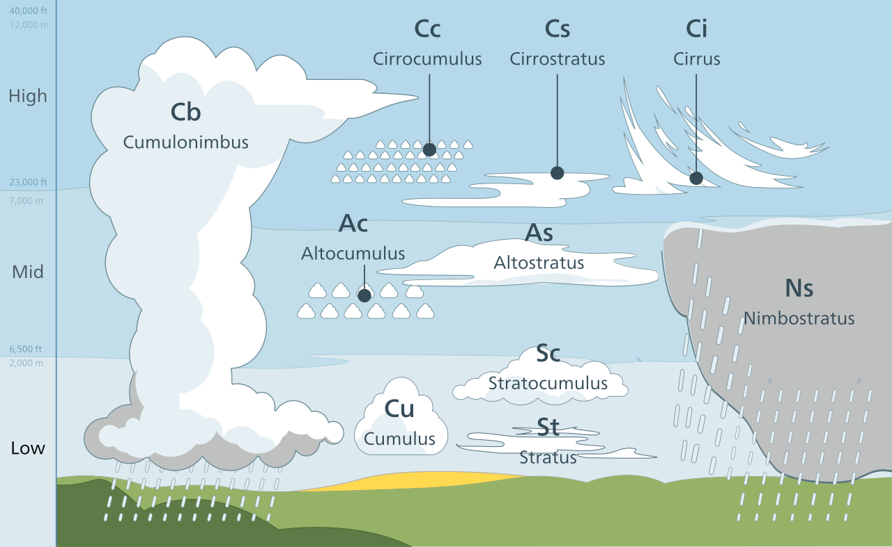

# 云的类型与常见高度

**表现形式**　比较型　　**主归属**　编目型

**读图问题**　遇到一种云时，如何用出现高度和外形缩小辨认范围？

## 数据逻辑与结构

一行可记录「云属名称｜缩写｜常见高度带｜外形｜降水提示」。左轴和分带给出高、中、低三层，也允许云体跨层。例图中的积雨云从低部延伸到高部。

## 统计图形与计算

借用高度分层与图鉴小图。纵向位置表达大致观测高度，图案表达形状差异。云朵大小和横向间隔服务于识别与排版，不能转译成频数，横向位置也没有量尺。

## 视觉编码

高层的丝缕、薄片或小块与低层大块、贴近地面的图形形成对照。缩写与全称贴近相应云体，细线指向较小的形状，降水用重复斜线提示。

## 信息架构

左侧高度标尺、后方高度分带和前景云形构成三层，云属缩写和全名是条目标签。某些云形横跨背景带，表示仅靠分组还不够。

## 视觉叙事架构

先按高度带缩小范围，再对照轮廓与标签，最后观察跨层和降水线索。以积雨云为例，单靠高度带会遗漏它，图鉴式形态编码在这里补足了分组的局限。

## 数据与编码检验

用 `云类 → 外观特征` 与 `云类 ↔ 高度层` 两张表。遇到跨高度的积雨云，关联表允许同一个云类出现多次。

将类别压成单一高度会丢掉原图跨层信息。轮廓是外观示意，分类从图例和标签读取。

## 来源与署名

- Valentin de Bruyn / Coton，2012 年
- [图像出处](https://commons.wikimedia.org/wiki/File:Cloud_types_en.svg)
- [CC BY-SA 3.0](https://creativecommons.org/licenses/by-sa/3.0/)。
- 仓库图片保存来源页提供的预览，保留完整画面。

[原图来源](原图来源.md) · [基础记录 CSV](基础记录.csv) · [字段说明](字段说明.md) · [返回类别目录](../README.md)
