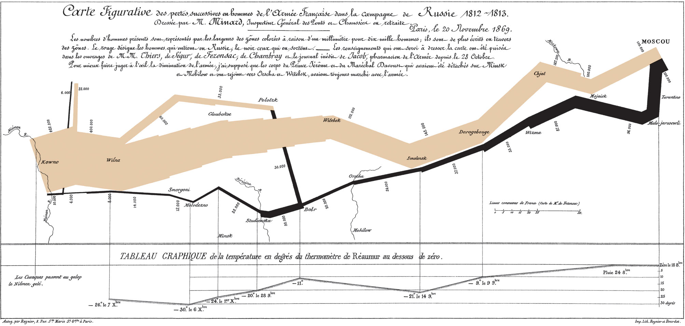

# 米纳尔 1812–1813 年俄国战役图

**所属类型**　混合型信息图形

**读图问题**　怎样让路线、兵力和撤退期间的温度出现在同一条叙事链上？

## 数据逻辑与结构

路线记录包含「地点｜行军方向｜在场人数」。温度记录另含「地点或对应横向位置｜日期｜温度」。两组记录借地点的横向位置对齐，但各自保留单位和解释。

## 统计图形与计算

流线图以带宽表达兵力，原图说明比例为每万人 1 毫米。下方折线在另一尺度上表现撤退温度，原单位是列氏度。方向、数量和温度无需换算到同一数轴。

## 视觉编码

浅棕色和黑色分别识别进入与撤退，带宽变细给出数量减少的线索，地名用于定位。竖向对应线把部分撤退位置和下方气温读数连接起来。

## 信息架构

路线图在上、温度图在下，各自保留说明与单位。路线中的地名和竖线提供跨图索引，把读者从撤退带引到下方读数。

## 视觉叙事架构

先沿浅色带读到莫斯科附近，再从右向左跟随黑带。下方气温折线应随撤退方向一起读。并置可以比较时间与位置上的共现，原图作者也说明了对分遣部队的处理假设。

## 数据与编码检验

原图标注 422,000 和 10,000。按 `原制图带宽毫米=人数/10000`，两端换算为 42.2 mm 和 1.0 mm。最终标注人数约为起点的 2.37%。

比值只比较图示两端的人数。行军分支在沿途分流和并入，图上的温度记录另有列氏温标。

## 来源与署名

- Charles Joseph Minard，1869 年
- [图像出处](https://commons.wikimedia.org/wiki/File:Minard.png)
- 来源页标记为公有领域。
