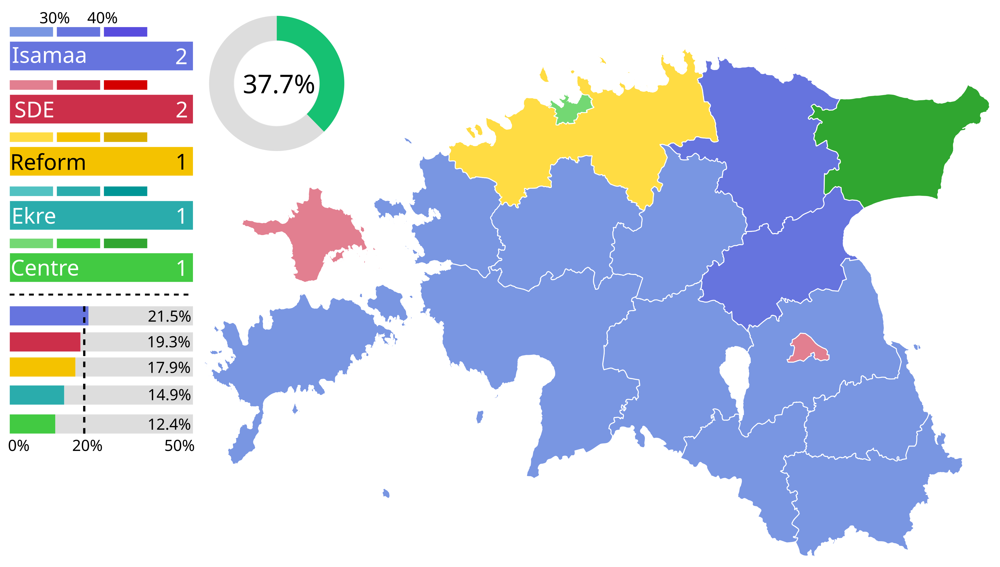

# 2024 年欧洲议会选举·爱沙尼亚结果图

**所属类型**　混合型信息图形

**读图问题**　怎样在一张图里同时看地区分布、全国得票率和席位？

## 数据逻辑与结构

用两张数据表组织图面。一张按地区记录相应类别及地图颜色，一张按政党记录全国得票率和席位。投票率是独立的全国汇总值。以 Isamaa 为例，图中的全国得票率为 21.5%，席位为 2。

## 统计图形与计算

左侧结合水平条形图、色块席位标签和环图。条形适合比较政党得票率，色块右端直接标席位，环图显示 37.7% 的投票率。各指标使用独立口径。原图未解释条形内的虚线，读图时可依据明确的数值标签。

## 视觉编码

同一政党在席位栏、比例条与地图中重复使用同一色系，位置和文字协助确认对象。地图各区域的白色边界提高比较效率。环图用绿色和灰色区分两部分，中央数字直接给出读数。

## 信息架构

右侧是空间分布的主图，左上是政党和席位，左下是得票率，旁边另放投票率。政党名称和一致颜色构成连接键，图形分工让空间与全国汇总可以交叉阅读。

## 视觉叙事架构

先从地图找空间格局，再用相关颜色回到左侧找政党，最后分别读比率和席位。例如 Isamaa 和 SDE 都标 2 席，条形却给出不同得票率。图例、条形和地图相互补充。

## 数据与编码检验

原图 Isamaa 21.5%、SDE 19.3%，相差 2.2 个百分点，图上同为 2 席。把 `party_id` 用作全国得票与地图类别的连接键，环图另存全国投票率。

得票率与席位可并列校核。投票率分母不同，应保留独立字段。

## 来源与署名

- MapperGuy87，2024 年。
- [图像出处](https://commons.wikimedia.org/wiki/File:2024-european-parliament-election-in-estonia.svg)
- [欧洲议会的爱沙尼亚全国结果](https://results.elections.europa.eu/en/national-results/estonia/2024-2029/)
- [CC0 1.0](https://creativecommons.org/publicdomain/zero/1.0/)。收录来源提供的完整 PNG 预览。
