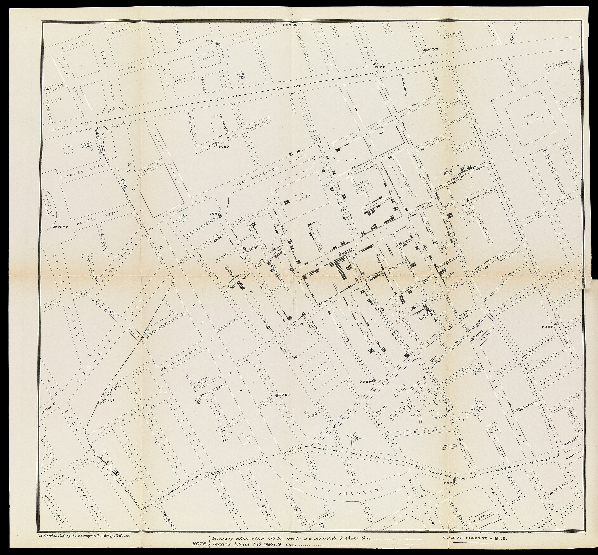

# 约翰·斯诺霍乱分布地图

**表现形式**　地标型　　**主归属**　地理图型

**读图问题**　1854 年伦敦这次霍乱暴发中，标在街区里的死亡记录在哪里聚集？

## 数据逻辑与结构

底图含街道与建筑位置。专题信息可拆成「地址或建筑位置｜死亡计数」与「水泵位置」两张表，用空间位置对照。保留当时出版的地图图面和报告语境。

## 统计图形与计算

借用位置图与重复计数。黑短划在地址附近叠放，读者可以比较局部集中程度，有了对应人口分母才适合做死亡率比较。图面上的距离还要通过地图比例理解。

## 视觉编码

浅色底图提供街道和街角的几何背景，密集黑划对比更强，水泵注记属于另一层。视觉重心来自街区里标记的聚集，而不是覆盖整张图的区域填色。

## 信息架构

先以街道框架组织地理空间，再叠加建筑附近的死亡标记和水泵位置。单个标记可定位，多个相邻标记共同构成聚集线索。

## 视觉叙事架构

先找图中央密集的街道，再把死亡标记与附近水泵一起读。地图可以帮助提出关联问题，解释病因还要结合原调查中其他证据。若改写为区域色图，会损失街道级细节。

## 数据与编码检验

记录按 `地址或街段, 计数, 点位类型` 组织。将表示死亡的线条转成位置和计数后，可按缓冲圈汇总。建议用多个距离阈值比较点位集中情况。

从图中数字化位置时，可保留 `图像坐标` 与 `地理坐标` 的区别，并记录是否已配准。

## 来源与署名

- John Snow，1854 年事件，选用 1855 年调查报告刊本。数字图像由 Wellcome Library 提供
- [图像出处](https://commons.wikimedia.org/wiki/File:A_map_taken_from_a_report_by_Dr._John_Snow_Wellcome_L0072917.jpg)
- [CC BY 4.0](https://creativecommons.org/licenses/by/4.0/)。图像署名 Wellcome Library, London。
- 仓库图片保存来源页提供的高清预览，保留完整画面。

[原图来源](原图来源.md) · [基础记录 CSV](基础记录.csv) · [字段说明](字段说明.md) · [返回类别目录](../README.md)
