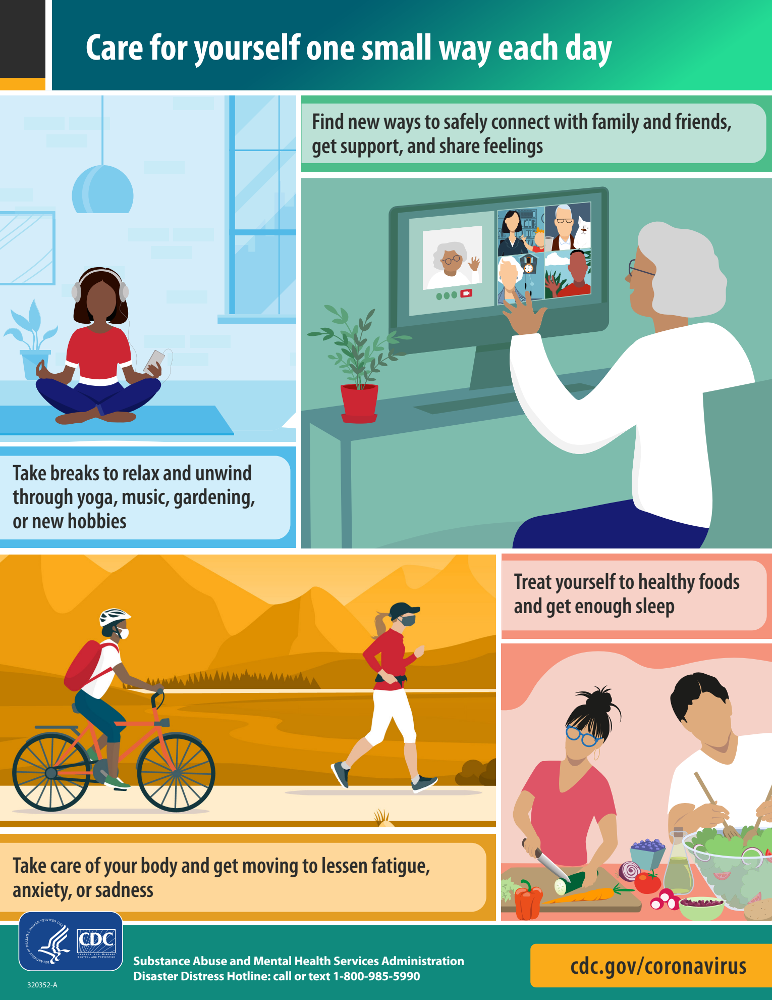

# 每天用一个小方法照顾自己

**所属类型**　文字型与列表型信息图形

**读图问题**　怎样把几条独立建议排成一张能快速扫读的海报？

## 数据逻辑与结构

信息单元是建议卡，可记录「主题｜行动句｜图示场景」。版面展示放松活动、保持联系、身体活动、均衡饮食与睡眠四组建议。读者可按自身需求选择，卡片之间没有步骤依赖。

## 统计图形与计算

借用卡片和小多图的排版逻辑，未展示频次或比例。运动场景的面积较大，是版面层级的选择，不能从面积推导某条建议更有效。

## 视觉编码

顶端大标题先交代主题，四块配色和插画把动作具体化。骑车和跑步共享一块，屏幕和人物对应远程联络。短句与画面通过贴合的横条标示配对。

## 信息架构

标题统领四组行动卡片。各卡的画面与短句靠近摆放，页脚再给出处和延伸信息，形成主题、建议、支持资源三级。

## 视觉叙事架构

先扫标题，再从最相关的场景入手，读完对应短句即可行动。四组共同支持一个主题。与物资清单相比，它更接近可任选的行动菜单。

## 数据与编码检验

先把每块插图和正文配对，再给每条记录 `category, caption, visual_asset`。同类别下如有多条建议，用子列表保存。

卡面面积用于版面布局。可以检验去掉图示后各条文字是否仍能独立定位。

## 来源与署名

- 美国疾病控制与预防中心（CDC），2020 年，海报编号 320352-A
- [图像出处](https://stacks.cdc.gov/view/cdc/99596)
- [CDC 海报原始 PDF](https://stacks.cdc.gov/view/cdc/99596/cdc_99596_DS1.pdf)
- CDC 公开海报，使用说明见 [CDC Stacks 政策](https://stacks.cdc.gov/about/policies)。引用仅用于课程图形分析。
- 仓库图片由来源 PDF 第 1 页完整渲染为 PNG。
