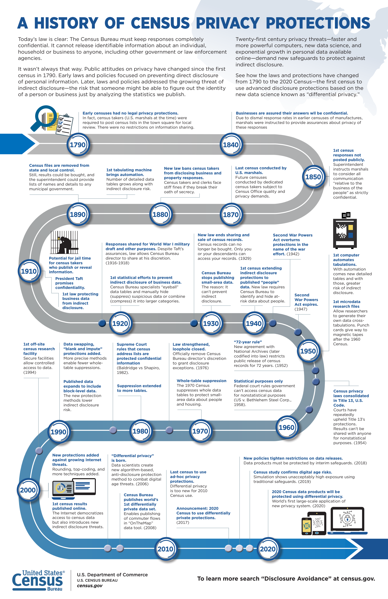

# 美国人口普查资料保密史时间轴

**所属类型**　时间轴型信息图形

**读图问题**　怎样把跨两个多世纪的政策与技术变化放进一页，并让读者跟得上顺序？

## 数据逻辑与结构

把资料拆成「年份｜事件｜说明｜事件类型」。大节点标出主要年代，圆点和引线容纳 2006、2008、2017 等补充事件。每个年代可以关联多条记录。

## 统计图形与计算

时间轴采用折返的线路。它保留顺序，并压缩较长的历史跨度。节点间隔受转折和注释空间影响，比较真实时间差时应读取年份标签。

## 视觉编码

由两端箭头交代阅读方向，大圆年份用统一描边，小圆点区分次级事件。每个时期的解释用细线就近连接，路线末段转成更深的蓝色。更新较密集的部分集中在图下方。

## 信息架构

顶部给背景和主题，中间的折返线路串联主年份，线路两侧布置事件卡片。大节点告诉读者身处哪个时期，次级节点补足同一时期内的细节。

## 视觉叙事架构

沿箭头从 1790 向右起读，到行尾后沿弯道换向。底部可对照 2000 年首次在网上公布普查结果和 2020 年节点的差分隐私做法。折返路线使密集文本仍能按先后顺序追踪。

## 数据与编码检验

逐个录年份并比较相邻间隔。`1790 → 1840` 是 50 年，`1840 → 1850` 是 10 年。折返图保留了年份次序，主节点之间的图上距离受文字和转角影响。

如果把这些选点重画为等比例时间轴，应先选共同的时间原点和单位，再考虑标签避让。

## 来源与署名

- United States Census Bureau，A History of Census Privacy Protections。
- [图像出处](https://www.census.gov/library/visualizations/2019/comm/history-privacy-protection.html)
- [机构发布的原始 PDF](https://www2.census.gov/library/visualizations/2019/communications/history-privacy-protection.pdf)
- 仓库中为原始 PDF 单页完整渲染的 PNG。
