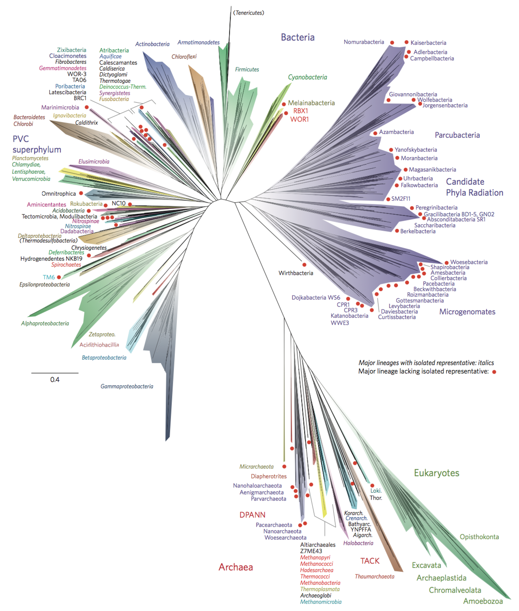

# 生命树的放射状系统发育图

**表现形式**　层级表现型　　**主归属**　层级型

**读图问题**　从密集的放射布局中，怎样读出拓扑、分支距离和额外的标注状态？

## 数据逻辑与结构

图面可拆成节点表和边表。节点含编号、名称和末端状态，边连接两个节点并承担分支长度。查找一个末端时沿连线退到分叉，再沿另一条边向外追踪。

## 统计图形与计算

放射布局把多条分支安排在图面各方位。原论文图中的左下标尺为 0.4。定量比较沿树枝的长度进行，外围标签的位置也会根据排版需要调整。

## 视觉编码

大类群的色块用于辨认。红点标示在论文图中缺少分离培养代表的主要谱系，斜体对应已有此类代表的主要谱系。可在右侧找到图例再回读标签。

## 信息架构

先找 Bacteria、Archaea 和 Eukaryotes 的文字索引，再缩小到具体分支。只抄显示出来的条目时，应把上位关系与图例状态分列。

## 视觉叙事架构

顺着连线回溯可定位两支共享的内节点。若需要全树校核，原文指向 Newick 文件及补充树图，图版适合做人工判读和编码分析。

## 数据与编码检验

以 `node_id, label, has_isolated_representative` 记视觉属性，另用 `source_id, target_id, length` 记边。打开图时用右下图例分别核对斜体与红点，线段沿枝测量并参照左下标尺。

扇区的面积、标签的极角和分支的线长承担不同作用。图版录入可通过反查连线发现错误归类。

## 来源与署名

- Hug 等，《A new view of the tree of life》，2016 年，图 1。
- [图版与授权](https://commons.wikimedia.org/wiki/File:A_Novel_Representation_Of_The_Tree_Of_Life.png)
- [原论文](https://doi.org/10.1038/nmicrobiol.2016.48)
- [CC BY 4.0](https://creativecommons.org/licenses/by/4.0/)。

[原图来源](原图来源.md) · [基础记录 CSV](基础记录.csv) · [字段说明](字段说明.md) · [返回类别目录](../README.md)
