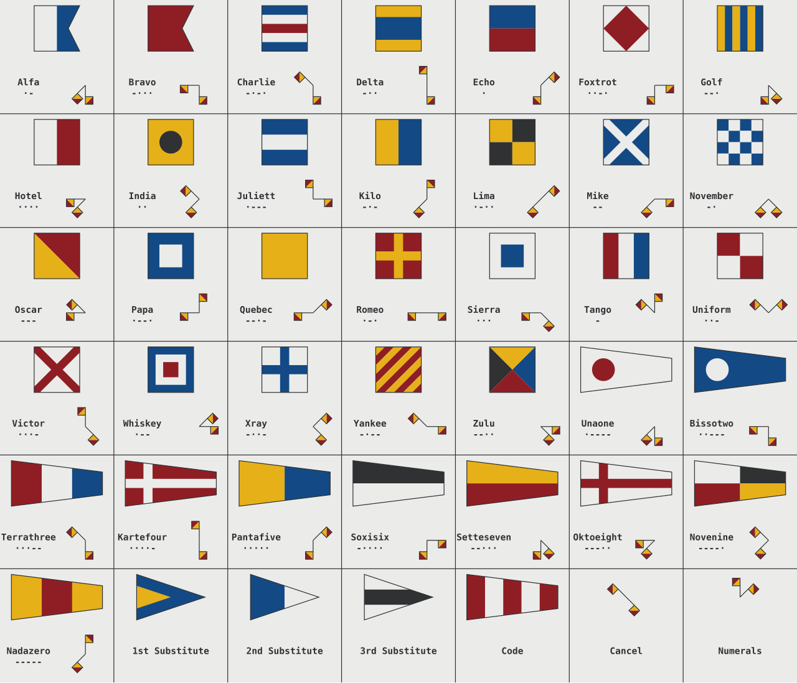

# 国际海事信号码对照图

**表现形式**　文字可视化　　**主归属**　字母表型

**读图问题**　同一个字母，能查到哪些不同通信形式？

## 数据逻辑与结构

每个格位对应一个字符或控制信号。以拉丁字母为主索引，可以记录「字符｜拼读词｜旗样｜摩尔斯码｜旗语动作」。图片以 A 到 Z 开头，随后依次接入数字旗与控制标记。

## 统计图形与计算

核心做法是多字段对照表。每格用同样的布局容纳多种属性。图中没有频次或比例尺度，查找结果是某个字符对应的编码组合。

## 视觉编码

以 B 为例，格内最大的是红色燕尾旗，左下方标 Bravo 和摩尔斯码，右下方画出双旗的相对位置。横线与竖线维持格位边界，旗形和色块便于远距离识别。

## 信息架构

先用字母顺序进入格位，再选择要读的那层编码。高处最大图形提供旗样，下部的词、点划和旗语动作各有固定区域。数字和控制信号在字母区末尾接续。

## 视觉叙事架构

读者可以顺着字母找到 B，然后在该格比较文字、图形和动作。也可以拿一面旗反查格位和拼读词。带固定位置的配对格式为双向查找提供了依据。

## 数据与编码检验

把字母作为主键。例 `B → Bravo → 红色燕尾旗 → -...`。轮廓与颜色可以各设一列，供识别器或人工反查共同使用。

数字旗和控制信号增加 `namespace` 字段。记录匹配时应先区分字母、数字或控制项。

## 来源与署名

- Michi83，绘制的国际信号码对照图。
- [图像出处](https://commons.wikimedia.org/wiki/File:International_Code_of_Signals.svg)
- [CC BY-SA 4.0](https://creativecommons.org/licenses/by-sa/4.0/)。收录来源提供的完整 PNG 预览。

[原图来源](原图来源.md) · [基础记录 CSV](基础记录.csv) · [字段说明](字段说明.md) · [返回类别目录](../README.md)
