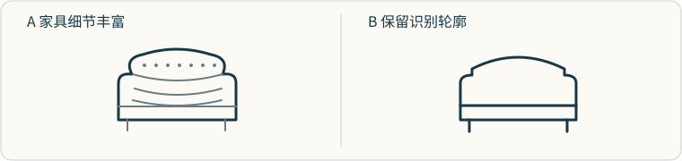

# 02-简单原则

Law of Simplicity / Prägnanz · 《交互信息设计》6.2.2

## 定义

当图形存在多种组织方式时，观看者倾向于把它组织成较简单、稳定的整体。

## 课件案例与设计分析

第 35 页的家具示例把繁复的椅子简化成座面、靠背、扶手和椅腿。去掉装饰后，椅子的识别结构仍然完整。

## 设计实践与检查

给信息图做分类图标时先保留关键轮廓，逐项删去纹理和细线，在实际显示尺寸上请同学说出图标代表什么。把容易混淆的类别放在一起检查。

## 来源

- 《交互信息设计_编辑版》，第 35 页。图例为依据课件概念绘制的示意。
- [Wertheimer（1923），Laws of Organization in Perceptual Forms](https://psychclassics.yorku.ca/Wertheimer/Forms/forms.htm)
- [返回原则总览](../README.md)
