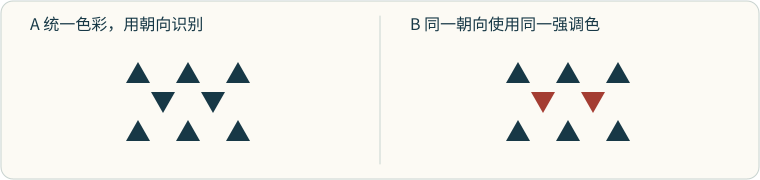

# 03-相似原则

Law of Similarity · 《交互信息设计》6.2.3

## 定义

颜色、形状或大小等视觉特征相似的元素，容易被归到一组。

## 课件案例与设计分析

第 36 页分别对照形状、大小、颜色。颜色示例保留三角形原来的位置和朝向，给两枚倒三角着色，颜色与朝向共同提示分组。

延伸阅读：[《财富》500 强都市区营收地图](../案例/01-财富500强都市区营收地图.md)。

## 设计实践与检查

多张图里的同一类别沿用同一种颜色，并配合形状或直接标签。将草稿转成灰度，请同学跨图查找同一类数据，检查是否还能顺利找到。

## 来源

- 《交互信息设计_编辑版》，第 36 页。图例为依据课件概念绘制的示意。
- [Wertheimer（1923），Laws of Organization in Perceptual Forms](https://psychclassics.yorku.ca/Wertheimer/Forms/forms.htm)
- [返回原则总览](../README.md)
