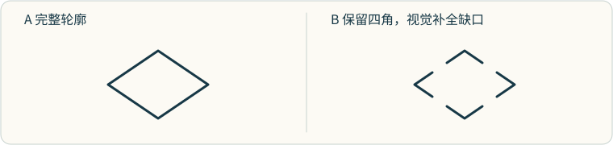

# 04-闭合原则

Law of Closure · 《交互信息设计》6.2.4

## 定义

轮廓部分缺失时，视觉会根据已有的边和角补全形状，看到一个整体。

## 课件案例与设计分析

第 37 页可结合第 41 页的菱形断边图读。四段折线各自保留一个拐角，线端的方向彼此呼应，观察者能补出菱形轮廓。

## 设计实践与检查

用断线简化小图标时保留角和转折，用递增长度的缺口做对照。标注统计缺失值时保留断线并写明缺测，避免观看者把缺测段补读成真实走势。

## 来源

- 《交互信息设计_编辑版》，第 37 页。图例为依据课件概念绘制的示意。
- [Wertheimer（1923），Laws of Organization in Perceptual Forms](https://psychclassics.yorku.ca/Wertheimer/Forms/forms.htm)
- [返回原则总览](../README.md)
