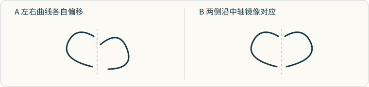

# 05-对称原则

Law of Symmetry · 《交互信息设计》6.2.5

## 定义

绕共同轴呈镜像的部分，容易被知觉组织为一个稳定整体。

## 课件案例与设计分析

第 38 页对应共享长图中的对称示例。下图用两条曲线对照，右侧曲线沿同一中轴镜像排列，两半更容易读成同一轮廓。

## 设计实践与检查

对照同一对象的两面或两阶段时，统一基线与比例，用中轴建立对应。隐藏装饰后检查两边的位置是否对应，并用清晰标注解释真实的数值差异。

## 来源

- 《交互信息设计_编辑版》，第 38 页。图例为依据课件概念绘制的示意。
- [返回原则总览](../README.md)
