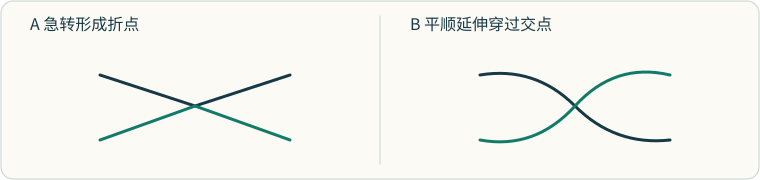

# 06-连续性原则

Law of Good Continuation / Continuity · 《交互信息设计》6.2.6

## 定义

视觉倾向于沿方向一致、平滑延伸的轮廓或路径继续追踪。

## 课件案例与设计分析

第 39 页可与第 41 页的点状曲线相互印证。离散的点沿平滑曲线排列时，容易被串成路径。相交曲线处，平顺的方向有助于追踪线的归属。

延伸阅读：[《财富》500 强都市区营收地图](../案例/01-财富500强都市区营收地图.md)。

## 设计实践与检查

绘制路径图时给每条路径保留连续走向和一致线型。让同学遮住终点标签，从一个起点沿线查找对应终点，记录在哪个交叉位置走错。

## 来源

- 《交互信息设计_编辑版》，第 39 页。图例为依据课件概念绘制的示意。
- [Wertheimer（1923），Laws of Organization in Perceptual Forms](https://psychclassics.yorku.ca/Wertheimer/Forms/forms.htm)
- [返回原则总览](../README.md)
