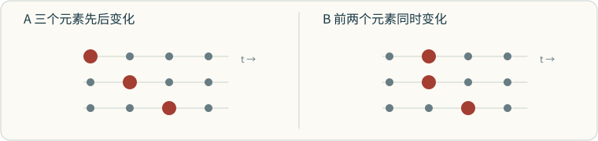

# 07-同步原则

Law of Synchrony · 《交互信息设计》6.2.7

## 定义

元素在相同时间发生变化时，容易被感知成一组。

## 课件案例与设计分析

第 40 页对应共享长图中的同步条目。下图用四个离散时刻重画时间对照，右侧前两行同一帧放大，即使空间位置保持不变，也会提示它们一起响应。

## 设计实践与检查

在交互图表中选中同一项时，让相应的地图点、图例、数值标注同时改变状态。用连续截图对齐改变发生的时刻，并保留静态选中状态，方便查看或关闭动效。

## 来源

- 《交互信息设计_编辑版》，第 40 页。图例为依据课件概念绘制的示意。
- [Alais、Blake 与 Lee（1998），Visual Synchrony Affects Binding and Segmentation in Perception](https://pubmed.ncbi.nlm.nih.gov/9671300/)
- [返回原则总览](../README.md)
