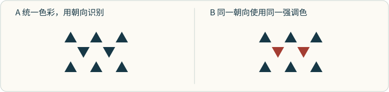

# G02 · 相似律

Similarity

## 定义

视觉属性相似的标记在同一场景中更容易被归组。

## 案例

- [Wertheimer 相似度点列](../02-案例库/G02-01.md)
- [《世界橡胶经济》](../02-案例库/G02-02.md)

## 实践检查

同一类别沿用形状和颜色，同时用直接文字或线型支持灰度读图。

[返回规则总览](../README.md)
