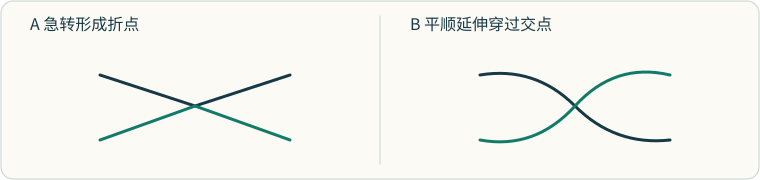

# G03 · 良好连续律

Good Continuation

## 定义

视觉倾向于沿平滑、方向相容的路径把分段或交叉的线条接续起来。

## 案例

- [Wertheimer 连续性线形演示](../02-案例库/G03-01.md)
- [《财富》都市区引线](../02-案例库/G03-02.md)

## 实践检查

跨线位置保留平滑走向，并用端点、线型或文字提高追踪正确率。

[返回规则总览](../README.md)
