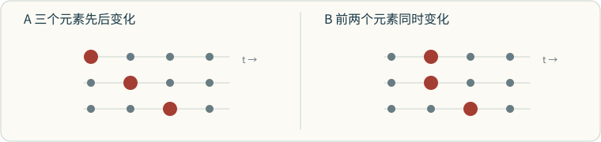

# G07 · 同步律

Synchrony

## 定义

同时发生变化的元素可能形成知觉组，成员的位置可保持不动。

## 案例

- [Alais 等的视觉同步实验](../02-案例库/G07-01.md)
- [Lee 与 Blake 的时间结构实验](../02-案例库/G07-02.md)

## 实践检查

使用地图点与列表的同步高亮说明联动，把触发状态保留为静态视觉提示以便复核。

[返回规则总览](../README.md)
