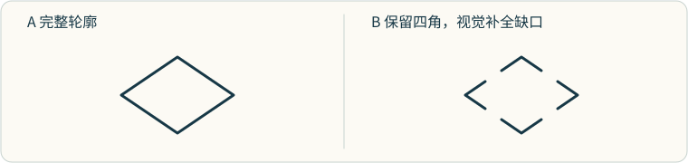

# G08 · 闭合律

Closure

## 定义

边界缺失时，视知觉可依据支持形状的片段补出连续轮廓。

## 案例

- [Kanizsa 主观轮廓示例](../02-案例库/G08-01.md)
- [Wertheimer 开闭轮廓分组](../02-案例库/G08-02.md)

## 实践检查

保留轮廓转折与切向线索。统计缺测用明确标注说明，避免读者主观补成实际数据。

[返回规则总览](../README.md)
