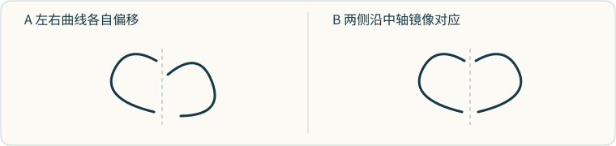

# G09 · 对称律

Symmetry

## 定义

沿共同中轴镜像对应的元素常被读成完整结构。

## 案例

- [《维特鲁威人》](../02-案例库/G09-01.md)
- [Rubin 杯形两侧轮廓](../02-案例库/G09-02.md)

## 实践检查

结构对读时保持基准线、方向和比例统一，用标注说明真正的两侧差异。

[返回规则总览](../README.md)
