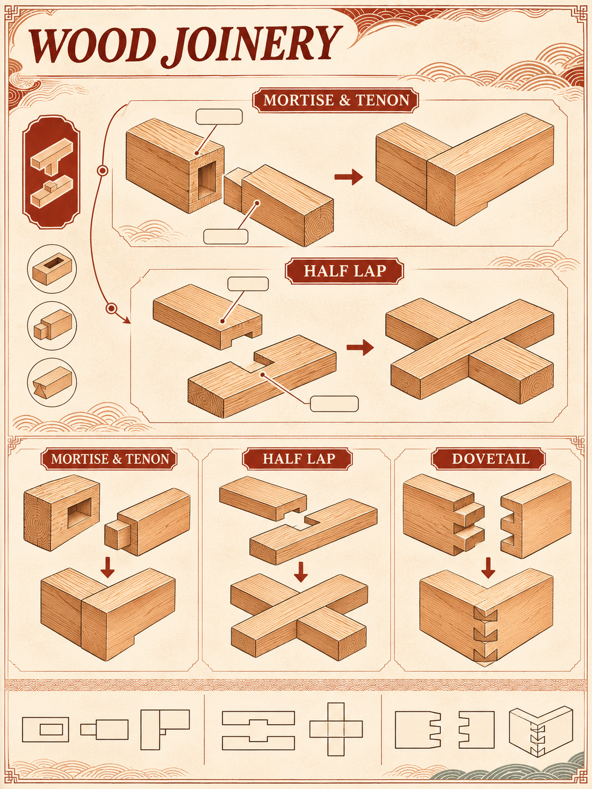

# 朱砂纸本图谱

视觉参考为 [本项目《唐构三殿》生图概念稿](../../../99-山西三座唐代木构殿宇主题信息图形设计/08-设计实施/03-最终交付/山西三座唐代木构殿宇.png)。测试主题为 **传统木构榫卯教学示意**。

| 固定风格变量 | 从参考中提取的规则 |
| --- | --- |
| 色彩 | 暖乳白纸底、砖红标牌、浅赭木色与深墨细线 |
| 构图与视觉锚点 | 纵版。偏心的主图带引线，上部两组剖解，下部为并排线描与细边框 |
| 材质、边缘与信息密度 | 轻微纤维纸纹，主体细线较清楚，背景留白低对比 |

新任务替换主题、对象、数据和措辞。光照、体积和输出比例由媒介与用途设定。

[中文 JSON](01-中文提示词.json) · [英文 JSON](02-英文提示词.json) · [中文简易版](03-中文简易提示词.md) · [自然语言版](04-自然语言提示词.md)

## 迁移测试与人工复核

使用内置 ImageGen 与参考图生成，四种提示词按同一风格档案整理。纸纹、朱砂牌、边框、引线和底栏均可辨认。测试图保留了两级图组。燕尾更接近角部燕尾拼接，主栏与底栏还有内容重复，因此只作为视觉测试，应用到技术图前需重绘节点并核对术语。
