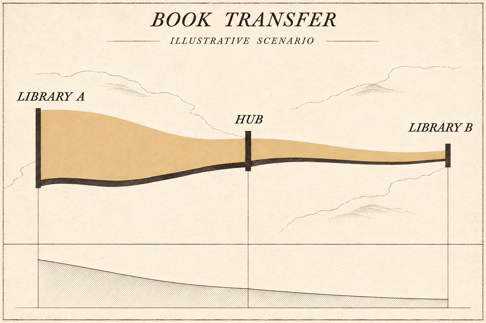

# 古典流线统计图

视觉参考为 [米纳尔 1812–1813 年俄国战役图](../../../02-信息图形类型案例/01-混合型/CASE-0101/分析.md)。测试主题为 **三站图书转运示例**。

| 固定风格变量 | 从参考中提取的规则 |
| --- | --- |
| 色彩 | 奶油纸、墨黑与低饱和赭色；地理背景用淡线 |
| 构图与视觉锚点 | 横版。上方路径由左至右，带宽逐段变窄。下方对照带用节点处竖线对齐 |
| 材质、边缘与信息密度 | 印刷纸纹与安静衬线体；背景弱、带线强 |

新任务替换主题、对象、数据和措辞。光照、体积和输出比例由媒介与用途设定。

[中文 JSON](01-中文提示词.json) · [英文 JSON](02-英文提示词.json) · [中文简易版](03-中文简易提示词.md) · [自然语言版](04-自然语言提示词.md)

## 迁移测试与人工复核

使用内置 ImageGen 与参考图生成，四种提示词按同一风格档案整理。图上只有三个节点，赭色带宽总体收窄，并用竖线连接底部趋势带。黑线与赭带的意义没有分开标注，专业统计用途须给各线补图例并按实际数量重画。
