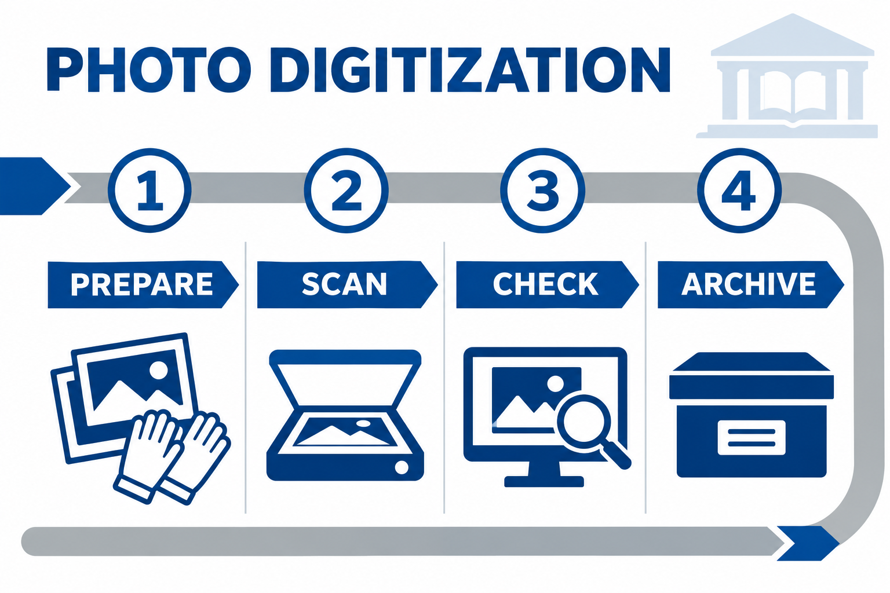

# 蓝白分步科普图

视觉参考为 [美国人口普查资料保密史时间轴](../../../02-信息图形类型案例/03-时间轴型/CASE-0302/分析.md)。测试主题为 **图书馆照片数字化**。

| 固定风格变量 | 从参考中提取的规则 |
| --- | --- |
| 色彩 | 深蓝和亮白为主，浅灰分隔，色彩层级克制 |
| 构图与视觉锚点 | 横版。四个编号自左向右排列，每步一枚图符与一行标签，间距一致 |
| 材质、边缘与信息密度 | 扁平实色图符，清楚的边界和大字号 |

新任务替换主题、对象、数据和措辞。光照、体积和输出比例由媒介与用途设定。

[中文 JSON](01-中文提示词.json) · [英文 JSON](02-英文提示词.json) · [中文简易版](03-中文简易提示词.md) · [自然语言版](04-自然语言提示词.md)

## 迁移测试与人工复核

使用内置 ImageGen 与参考图生成，四种提示词按同一风格档案整理。四步图符、标签及编号清晰，深蓝白配色一致。底部的回折线容易让人误以为还有回程。实际使用时删去回折段，并在 ARCHIVE 处明确结束。
